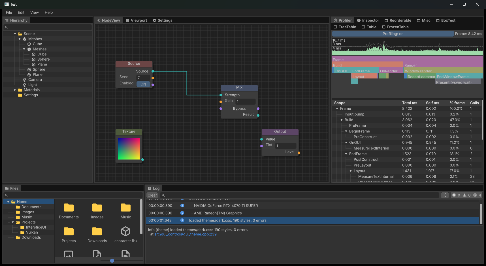

# IntersticeUI

A C++20 GUI library for tools and editors. Build the UI each frame in code; the
library keeps the state, lays it out with flexbox and grid, and draws it.

- Docking panels, multiple OS windows, menus, tooltips and drag and drop
- Controls: buttons, text and numeric fields, sliders, color and gradient
  editors, tables, trees, list and grid views, node graphs
- Styles from CSS files, with dark and light themes, UI scaling and font scaling
- Text shaping, bidirectional text and font fallback for most scripts



The UI draws through a graphics backend and gets windows and input from a window
backend, so it isn't tied to one graphics API or platform. The current backends
are Vulkan and SDL3.

The library is two static libraries:

| Library | Contents |
| --- | --- |
| `gui_core` | Windowing, rendering backends, input, layout, text, styles, element storage |
| `gui_controls` | `GUIApplication`, controls, docking, menus, tooltips, transitions |

## Requirements

- Windows x64 with Visual Studio 2022 (MSVC) and CMake 3.22 or newer
- The [Vulkan SDK](https://vulkan.lunarg.com/): headers, loader and
  `glslangValidator` for the shaders; the GPU tests also use its validation layers
- Git with [Git LFS](https://git-lfs.com/): the fonts are stored in LFS, and a
  clone without it only has pointer files, so the fonts fail to load
- Network access on the first configure
- At runtime, a GPU driver with Vulkan 1.3, `VK_KHR_swapchain` and the features
  listed by `Vulkan::VulkanDeviceContext::GetDeviceRequirements()` (dynamic
  rendering, synchronization2, descriptor indexing, buffer device address, 8- and
  16-bit storage, among others)

## Build

```text
git clone --recursive https://github.com/LogicalError/IntersticeUI.git
cd IntersticeUI
cmake -S . -B build -G "Visual Studio 17 2022" -A x64
cmake --build build --config Debug
```

In an existing clone without the submodules, run
`git submodule update --init --recursive`; configure stops with that hint when
they are missing.

The first configure builds the third-party libraries once into
`build/third_party/install`; later builds reuse them. Executables land in
`bin/<config>`.

| Option | Default | |
| --- | --- | --- |
| `INTERSTICE_BUILD_DEMO` | on when top-level | The demo application |
| `INTERSTICE_BUILD_EXAMPLES` | on when top-level | The programs in `examples/` |
| `INTERSTICE_BUILD_TESTS` | on when top-level | The unit and GPU tests |
| `INTERSTICE_INSTALL_THIRD_PARTY` | on | Bundle the third-party libraries into the install |

As a subproject (`add_subdirectory`), only the libraries are built by default.

## Run the demo, examples and tests

`demo` is a testbed that shows most of the library; it is not part of it. It
loads its files relative to the working directory:

```text
cd workdirectory
..\bin\Debug\demo.exe               rem --ui-scale 1.5 zooms the UI
```

`examples/` has small programs that each show one thing and run from any folder:

| Example | Shows |
| --- | --- |
| `hello_world` | A window with a text field and buttons |
| `controls` | The common controls, laid out as label/value rows |
| `docking` | Panels in a dock layout |
| `custom_theme` | An app's own CSS file, dark/light palettes, font scaling |
| `host_device` | Hosting on the app's own Vulkan device and showing an image it renders |

The tests find `workdirectory` themselves:

```text
bin\Debug\gui_core_tests.exe        rem unit tests, no GPU needed
bin\Debug\gui_gpu_tests.exe         rem real-device tests, skipped without a GPU
ctest --test-dir build -C Debug     rem both, one process per test
```

## Hello world

```cpp
#include <gui_controls/gui_application.h>

#include <string>

class HelloApp : public GUI::GUIApplication
{
public:
    bool Initialize(const InitializeOptions& options = {}) override
    {
        if (!GUIApplication::Initialize(options))
            return false;
        windowID = idManager.CreateStaticID();   // windows need stable IDs
        return true;
    }

    // Called every frame: describe the whole UI; the library keeps the state.
    void OnGUI() override
    {
        if (BeginWindow(windowID, "Hello", GUI::LayoutOverride{}.Size(360, 160)))
        {
            BeginVertical(GUI::LayoutOverride{}.FlexGrow(1));
            BeginLabelGroup();
            Label("Name");
            Field(name);
            EndLabelGroup();
            Button("Greet", [this] { greeting = "Hello, " + name + "!"; });
            Text(greeting);
            EndVertical();
            EndWindow();
        }
    }

private:
    GUI::ID     windowID = GUI::ID::Invalid();
    std::string name     = "world";
    std::string greeting;
};

int main()
{
    HelloApp app;
    app.SetResourceRoot("path/to/resources");   // see below
    if (app.Initialize())
        app.Run();   // until the last window closes
    app.Cleanup();
}
```

## Runtime files

An application ships these files, in this layout:

| Folder | Contents |
| --- | --- |
| `shaders_compiled/` | The compiled shaders (built from `workdirectory/shaders`) |
| `fonts/Noto-otf/` | The default fonts and the fallback fonts for other scripts |
| `fonts/Inter/` | The UI font the themes use |
| `themes/` | `dark.css` and `light.css` (palettes) and `styles.css` (the rules) |

`GUIApplication::SetResourceRoot` sets the folder they are loaded from; without it
they load relative to the working directory. In the source tree they are in
`workdirectory/`; an installed package has them in `share/IntersticeUI/resources`.
`icons/` holds the demo's SVG icons, which an app may use but doesn't need.
`SDL3.dll` must be next to the executable; the build copies it there.

An application adds its own styles with `SetStyleFiles`, which loads more CSS
files after `styles.css`, and finds their classes with `theme.GetStyle("name")`.
`examples/custom_theme.cpp` shows both. `RequestReloadTheme` switches palettes
or the font scale at runtime.

## Use as a package

`cmake --install` produces a self-contained package: both libraries, their
headers, the runtime files, the bundled third-party libraries, the license
files and a CMake package configuration.

```text
cmake --install build --config Debug   --prefix <prefix>
cmake --install build --config Release --prefix <prefix>
```

Debug and Release install side by side into the same prefix. A consumer then
needs no IntersticeUI source or build tree:

```cmake
find_package(IntersticeUI 0.1 CONFIG REQUIRED)
target_link_libraries(my_app PRIVATE IntersticeUI::gui_controls)
```

The package defines `INTERSTICE_RESOURCE_DIR` for code that links it, so
`app.SetResourceRoot(INTERSTICE_RESOURCE_DIR)` loads the installed runtime files;
CMake code can use `IntersticeUI_RESOURCE_DIR`. `tests/package_consumer` is a
minimal consumer that checks this against an installed prefix.

The consumer must use the same toolchain as the package. Only the Debug and
Release configurations are installed; other configurations need
`CMAKE_MAP_IMPORTED_CONFIG_<CONFIG>` in the consumer.

## Vulkan backend

When a host application also renders with Vulkan, it can share its device and
images with the GUI. `examples/host_device.cpp` does both.

### Sharing the host's device

By default the GUI creates and owns its own `VkInstance` and `VkDevice`. A host
application that already owns a device, such as a game engine hosting this GUI
as its editor, can hand its handles to the GUI so both render on the same
device:

```cpp
GUI::GUIApplication app;
app.configureGraphicsContext = [&](GUI::GraphicsContext& context)
{
    auto& vk = static_cast<Vulkan::VulkanGraphicsContext&>(context);
    Vulkan::VulkanDeviceContext::ExternalDevice external;
    external.instance            = hostInstance;
    external.physicalDevice      = hostPhysicalDevice;
    external.device              = hostDevice;
    external.graphicsQueue       = hostGraphicsQueue;
    external.graphicsQueueFamily = hostGraphicsQueueFamily;
    external.queueMutex          = &hostQueueMutex;   // optional, see below
    vk.deviceContext.SetExternalDevice(external);
};
app.Initialize();
```

`configureGraphicsContext` runs inside `Initialize`, after the window backend is
up and before the GUI creates a device of its own.

Requirements on the host device:

- `Vulkan::VulkanDeviceContext::GetDeviceRequirements()` lists the API version,
  features, and device extensions the GUI needs. Enable all of them when
  creating the device. `CheckPhysicalDeviceSupport` reports what a physical
  device lacks. The GUI checks this when it adopts the device, and fails
  initialization with a message if the device cannot run it. It cannot see what
  the host actually enabled at device creation.
- The instance must enable the extensions the window backend needs to create
  surfaces (for SDL, `SDL_Vulkan_GetInstanceExtensions`).
- The queue must support graphics and presentation to the GUI's windows.

Ownership: the GUI destroys only what it created. A host-provided instance,
device, and allocator belong to the host and survive `Cleanup`. If the host
passes no `VmaAllocator`, the GUI creates and owns its own.

Threading: a Vulkan queue needs external synchronization. The GUI locks
`queueMutex` around every `vkQueueSubmit2` and `vkQueuePresentKHR` it issues. A
host that submits to the same queue from other threads must pass the mutex it
locks around its own submissions. Note that presentation can block until vsync
while the lock is held; a host with a second graphics queue should give the GUI
its own queue to avoid that.

### Showing a host-rendered image

A host can render into an image it owns and show it in the UI, for example a
3D viewport:

```cpp
auto& vk = static_cast<Vulkan::VulkanGraphicsContext&>(*graphicsContext);
GUI::ImageIndex index = vk.RegisterExternalImage(view, sampler);   // once
vk.UpdateExternalImage(index, newView, sampler);                   // after a resize

Image(index, GUI::uint2{ width, height });   // in OnGUI
```

`Image` uses `theme.imageStyleRef`. A custom element or style shows the image only
when its background color style is of type `ColorType::StretchedTexture`. The view
and sampler stay owned by the host and must outlive every GUI frame that
references the index.

Synchronization contract (all on the one queue given to `SetExternalDevice`):

1. By the end of the command buffer it submits for the frame, the host leaves the
   image in `VK_IMAGE_LAYOUT_SHADER_READ_ONLY_OPTIMAL` with its writes visible to
   the fragment stage (destination stage `FRAGMENT_SHADER`, access `SHADER_SAMPLED_READ`).
2. Before writing the image again, the host transitions it away with a source stage
   of `FRAGMENT_SHADER`, so the write waits for the GUI's earlier reads.
3. The host submits during the UI build phase (`OnGUI`), before the GUI prepares and
   submits the frame. Submission order on one queue makes both barriers effective
   across command buffers.

After a resize the host must make sure no in-flight GUI frame still samples the old
view; the simplest way is `vkDeviceWaitIdle`. `tests/gpu/gpu_external_device_test.cpp`
exercises the contract under synchronization validation.

## Dependencies

Install yourself: the Vulkan SDK, Visual Studio 2022, CMake, Git and Git LFS
(see [Requirements](#requirements)).

Handled by the build:

| Dependency | How |
| --- | --- |
| SDL3, skribidi, googletest, VMA, vk-bootstrap | Git submodules |
| HarfBuzz, SheenBidi, libunibreak, budouxc | Downloaded by skribidi on the first configure |
| nanosvg | Included in the repository |

## Status

Version 0.1, a preview under active development. Windows x64 with Vulkan is the
only platform so far; the backends are separate from the rest so others can follow.

Known issues:

- Vulkan backend: the running editor reports validation errors; the descriptor
  related ones are not yet investigated.
- The Khronos validation layer shipped with Vulkan SDK 1.4.341.1 crashes (a null
  read on one of its worker threads) in tests that present to a window. This is
  not a GUI defect: it goes away with the 1.4.309 layer, with which all GPU tests
  pass, including synchronization validation. Point the loader at an older layer
  to work around it, for example `set VK_LAYER_PATH=C:\VulkanSDK\1.4.309.0\Bin`.
  A debug build of an application that enables validation layers is affected the
  same way. Crashes in the GPU tests print a symbolized stack trace, and
  `INTERSTICE_GPU_TEST_NO_SYNC_VALIDATION=1` runs them with core validation only.
- Visual Studio 2026 (MSVC 19.51) builds the project, but CI only checks
  Visual Studio 2022.
- Docking layouts can be saved and restored (`SerializeDockTree` / `ParseDockTree` in
  `gui_controls/gui_dock_node.h`); the application chooses where to store them.
  Floating windows are not part of the saved tree.
- Text editor undo and redo (Ctrl+Z, Ctrl+Shift+Z) exist; whether they behave
  correctly across focus changes and with application-level undo has not been checked.

## License

IntersticeUI is licensed under the MIT license; see [LICENSE](LICENSE). The
bundled third-party code, fonts and icons keep their own licenses, listed in
[THIRD_PARTY_NOTICES.txt](THIRD_PARTY_NOTICES.txt).
