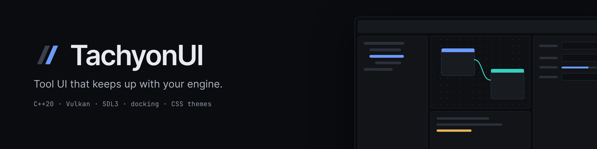

<p align="center">
  
</p>

<p align="center">
  An immediate-mode <b>C++20</b> GUI library for editors and tools —<br>
  docking, real controls, CSS themes, on <b>Vulkan</b>.
</p>

<p align="center">
  <a href="https://github.com/LogicalError/TachyonUI/actions/workflows/ci.yml"></a>
  <a href="https://logicalerror.github.io/TachyonUI/"></a>
  
  
  
  <a href="LICENSE"></a>
</p>

<p align="center">
  <a href="docs/README.md"><b>Guides</b></a> ·
  <a href="https://logicalerror.github.io/TachyonUI/"><b>API reference</b></a> ·
  <a href="examples/"><b>Examples</b></a> ·
  <a href="CHANGELOG.md"><b>Changelog</b></a>
</p>


## At a glance

| **Docking & windows** | **Tool-grade controls** | **CSS themes** |
| --- | --- | --- |
| Dock, tab and tear off panels into OS windows. Menus, tooltips, drag and drop. | Fields, sliders, color & gradient editors, tables, trees, list/grid views, node graphs. | Dark and light palettes, UI and font scaling, your own stylesheets, runtime reload. |
| **Layout** | **Text** | **Engine-ready** |
| Flexbox and grid, in CSS px scaled by the UI scale. | Shaping, bidi and font fallback for most scripts. | Share your Vulkan device, show your images, render the UI into a texture. |

## Quick start

You need the [Vulkan SDK](https://vulkan.lunarg.com/), [Git LFS](https://git-lfs.com/) (the fonts live there),
CMake 3.22+ and MSVC 2022+, GCC 13 or Clang 17. [Full requirements ↓](#reference)

```sh
git clone --recursive https://github.com/LogicalError/TachyonUI.git
cd TachyonUI
cmake -S . -B build              # add -G "Ninja Multi-Config" on Linux/macOS
cmake --build build --config Debug
cd workdirectory && ../bin/Debug/showcase
```

## Hello world

Describe the whole UI every frame; the library keeps the state.

```cpp
void OnGUI() override
{
    if (BeginWindow(windowID, "Hello", LayoutOverride{}.Size(360, 160)))
    {
        Label("Name");  Field(name);
        Button("Greet", [this] { greeting = "Hello, " + name + "!"; });
        Text(greeting);
    }
    EndWindow();   // always, whatever BeginWindow returned
}
```

The full program is [examples/hello_world/hello_world.cpp](examples/hello_world/hello_world.cpp). Frame model, IDs and the
Begin/End rules: [docs/overview.md](docs/overview.md).

## Examples

Each one is a folder in [`examples/`](examples); [docs/examples.md](docs/examples.md) walks through them.

| Example | Shows |
| --- | --- |
| `hello_world` | A window with a text field and buttons |
| `controls` | The common controls, as label/value rows |
| `docking` | Panels in a dock layout |
| `custom_theme` | Your own CSS, dark/light palettes, font scaling |
| `host_device` | Running on your Vulkan device and showing an image it renders |
| `showcase` | An editor-style app with most of the library in its panels (the screenshot above) |

## Use it in your project

```cmake
find_package(TachyonUI 0.1 CONFIG REQUIRED)       # after cmake --install
# or: add_subdirectory(external/TachyonUI)
target_link_libraries(my_app PRIVATE TachyonUI::gui_controls)
```

Then `app.SetResourceRoot(TACHYON_RESOURCE_DIR)`. Packaging, subprojects and system libraries:
[docs/integration.md](docs/integration.md).

## Inside an engine

- **Share the host's Vulkan device** — one instance, device and queue; the GUI destroys only what it created.
- **Show a host-rendered image** — a 3D viewport as a control.
- **Render the UI into an image** — no OS window; you inject input.

Synchronization contracts and code: [Using your own Vulkan device](docs/integration/vulkan-device.md).

## Reference

<details>
<summary><b>Full requirements</b> — compilers, Vulkan features, LFS</summary>

- Windows x64 with Visual Studio 2026 (MSVC) and CMake 4.2 or newer; Visual Studio 2022 with CMake 3.22 or newer also works
- Linux x64 with GCC 13 or Clang 17 or newer, Ninja and CMake 3.22 or newer, and the X11 and Wayland development
  packages for SDL3 (see the Linux job in `.github/workflows/ci.yml` for the Ubuntu package list)
- macOS (untested: CI builds it with Apple Clang against MoltenVK from Homebrew and runs the headless tests,
  but it has never run on a Mac)
- The [Vulkan SDK](https://vulkan.lunarg.com/): headers, loader and `glslangValidator` for the shaders;
  the GPU tests also use its validation layers
- Git with [Git LFS](https://git-lfs.com/): a clone without it only has pointer files, so the fonts fail to load
- At runtime, a GPU driver with Vulkan 1.3, `VK_KHR_swapchain` and the features listed by
  `tachyon::vulkan::VulkanDeviceContext::GetDeviceRequirements()`

In an existing clone without the submodules, run `git submodule update --init --recursive`.
The first configure builds the third-party libraries once into `build/third_party/install`.
</details>

<details>
<summary><b>CMake options</b> — <code>TACHYON_*</code></summary>

| Option | Default | |
| --- | --- | --- |
| `TACHYON_BUILD_SHOWCASE` | on when top-level | The showcase application (`examples/showcase`) |
| `TACHYON_BUILD_EXAMPLES` | on when top-level | The small examples in `examples/` |
| `TACHYON_BUILD_TESTS` | on when top-level | The unit and GPU tests |
| `TACHYON_INSTALL` | on when top-level | The install rules and the CMake package |
| `TACHYON_INSTALL_THIRD_PARTY` | on | Bundle the third-party libraries into the install |
| `TACHYON_SDL` | on | The SDL window backend; off builds without SDL |
| `TACHYON_SYSTEM_SDL`, `_HARFBUZZ`, `_VMA` | off | Use the host's copy of that library |
| `TACHYON_FALLBACK_FONTS` | off | Copy and install the Noto fallback fonts |
</details>

<details>
<summary><b>Runtime files to ship</b> — shaders, fonts, themes</summary>

| Folder | Contents |
| --- | --- |
| `shaders_compiled/` | The compiled shaders (built from `workdirectory/shaders`) |
| `fonts/Inter/`, `fonts/JetBrainsMono/` | The built-in fonts |
| `fonts/Noto-otf/` | Optional fallback fonts, loaded with `InitializeOptions::fallbackFonts` |
| `themes/` | `dark.css`, `light.css` (palettes) and `styles.css` (the rules) |

`SetResourceRoot` sets where they load from. `SDL3.dll` must be next to the executable; the build copies it there.
</details>

<details>
<summary><b>Running the tests</b> — unit, GPU, ctest</summary>

```text
bin\Debug\gui_core_tests.exe        rem unit tests, no GPU needed
bin\Debug\gui_gpu_tests.exe         rem real-device tests, skipped without a GPU
ctest --test-dir build -C Debug     rem both, one process per test
```
</details>

## Status

**0.1 preview** — under active development; APIs will change. Windows x64 and Linux x64 are built and tested in CI.
macOS builds in CI against MoltenVK and runs the headless tests, but has not run on a Mac.

---

[Contributing](CONTRIBUTING.md) · [Security](SECURITY.md) ·
[Sponsor on GitHub](https://github.com/sponsors/LogicalError) · [Patreon](https://www.patreon.com/c/logicalerror)

MIT licensed. Bundled third-party code, fonts and icons keep their own licenses, listed in
[THIRD_PARTY_NOTICES.txt](THIRD_PARTY_NOTICES.txt).
